<div align="center">

# AgentTown

### 코딩하는 동안, 작은 마을에서는 모험이 시작됩니다.

**AI 에이전트의 작업을 도트 캐릭터로 만나는 로컬 작업실.**<br>
문을 열고 출근하고, 몬스터와 싸우고, 가끔은 작은 주민이 전설의 검을 뽑습니다.

**실시간 세션 · 무음 알림 · 던전 전투 · 장비와 펫 · 공동 토벌**

[화면 둘러보기](#작업이-모이는-작은-마을) · [전투와 기술](#작업을-기다리는-동안-한-판) · [설치하기](#시작하기) · [자세한 실행 안내](docs/INSTALL.md)

</div>

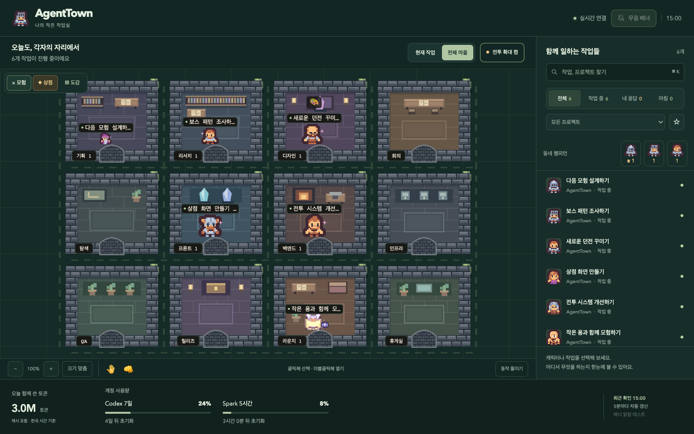

> 이 페이지의 이미지는 **실제 앱에서 캡처**했습니다. 공개 촬영을 위해 세션 제목·토큰·사용량·장비와 전투 상황은 데모 데이터로 구성했습니다. 화면과 기술 효과는 현재 구현된 렌더러를 그대로 사용합니다.

## 작업이 모이는 작은 마을

터미널과 작업 목록을 번갈아 보는 대신, 각 세션이 지금 무엇을 하는지 마을에서 살펴보세요. 도구 사용에 따라 방을 옮기고, 답변을 기다리는 주민은 라운지에 모입니다.

| 일하는 모습을 한눈에 | 필요할 때 바로 이어서 |
| --- | --- |
| 세션마다 하나의 캐릭터, 토큰 사용량에 따라 달라지는 몸집 | 한 번 클릭하면 작업 제목·모델·최근 도구·토큰 확인 |
| 가까운 방은 문과 복도를 따라 걷고, 먼 방은 포탈로 이동 | 더블클릭하면 해당 Codex 작업 열기¹ |
| 작업 중·내 응답 필요·완료 상태와 계정 한도 표시 | 검색, 프로젝트 필터, 즐겨찾기, 지도에서 찾기 |
| 작은 창에서는 작업 목록과 하단 사용량을 간결하게 표시 | 응답 요청·답변 완료를 **소리 없는 배너**로 알림¹ |

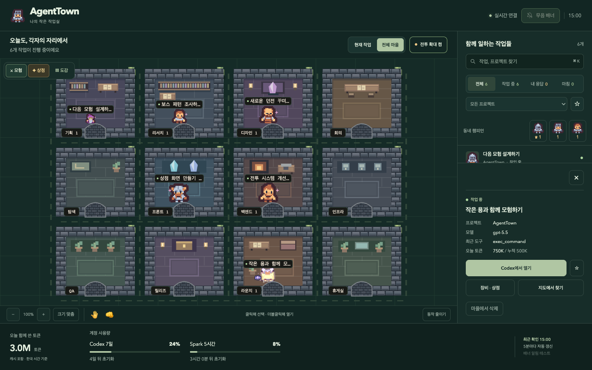

<details>
<summary><strong>작은 창의 정돈된 버튼 배치도 보기</strong></summary>

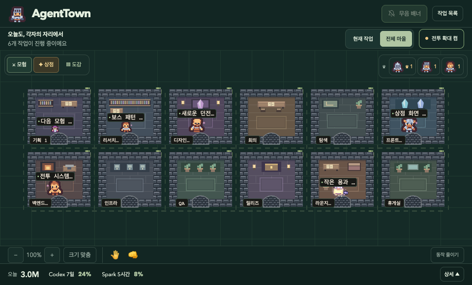

</details>

상단의 **전투 확대 켬/끔**으로 큰 전투 화면을 선택할 수 있습니다. 끄면 마을 화면을 유지하면서 전투와 보상은 계속 진행됩니다. 상점·도감·작업 목록을 보는 동안에는 새 전투가 기다립니다.


¹ 작업 바로 열기와 네이티브 알림은 데스크톱 앱 기능입니다. 작업 열기는 `codex://`를 처리하는 Codex 앱이 필요하며, 배너 표시는 운영체제 알림 설정을 따릅니다.

## 작업을 기다리는 동안, 한 판

마을에는 몬스터가 돌아다닙니다. 주민과 마주치면 전투가 시작되고, **체력·공격력·방어력·치명타·장비**로 승부가 결정됩니다. 작은 주민은 패배할 수도 있고, 강한 보스는 여러 차례 공격해야 쓰러집니다.

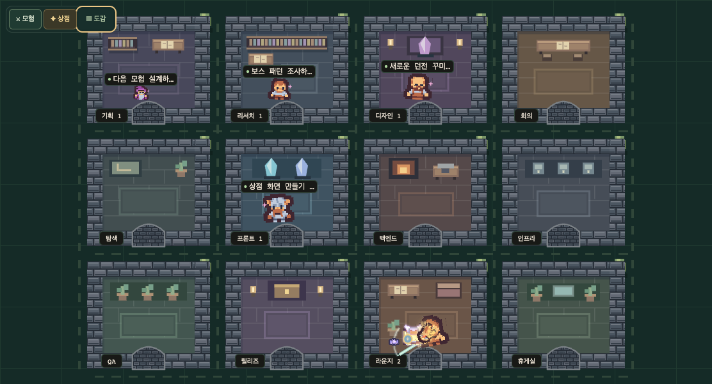

- **주민 대전** — 실제 체력으로 겨루고, 상대 등급에 따른 별가루와 승리 기록을 얻습니다. 같은 두 주민은 같은 방에 머무는 동안 계속 재대결하지 않습니다.
- **몬스터 사냥** — 1~10단계 몬스터와 보스, 그리고 12·14·16단계 상위 보스. 더 강한 적에게 더 큰 보상이 걸려 있습니다.
- **공격의 리듬** — 기를 모으고, 다가가서 휘두르고, 맞은 쪽이 밀려납니다. 피해가 클수록 더 크게 밀리고 기울며, 전투가 10초를 넘으면 1.3배속으로 진행됩니다. 전투가 끝나면 미뤄 둔 방 이동을 이어갑니다.
- **중간에도 스킬 발동** — 마지막 공격뿐 아니라 전투 중에도 확률적으로 기술을 사용합니다. 보스에게는 고유 필살기도 있습니다.

### 다섯 가지 일격, 다섯 가지 연출

색만 바뀌는 공격이 아닙니다. 불기둥, 낙뢰, 파도, 교차 칼날, 연속 참격이 서로 다른 움직임으로 펼쳐집니다.

| 화염 · 불기둥과 지면 폭발 | 번개 · 연쇄 낙뢰 |
| :---: | :---: |
| 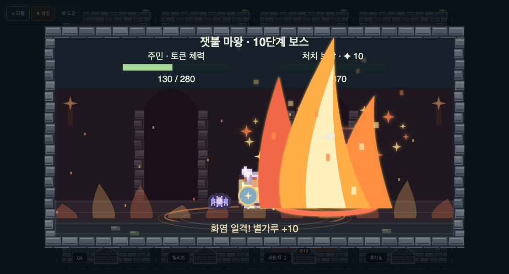 | 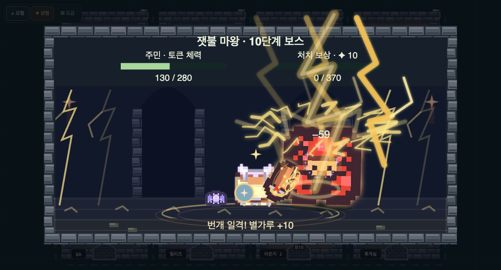 |
| **물 · 솟구치는 파도** | **바람 · 교차하는 칼날** |
| 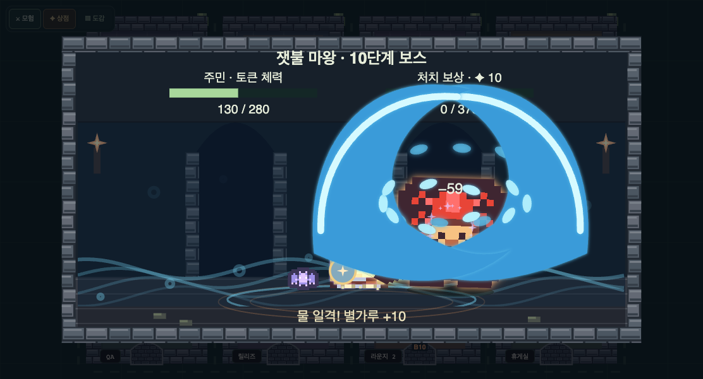 | 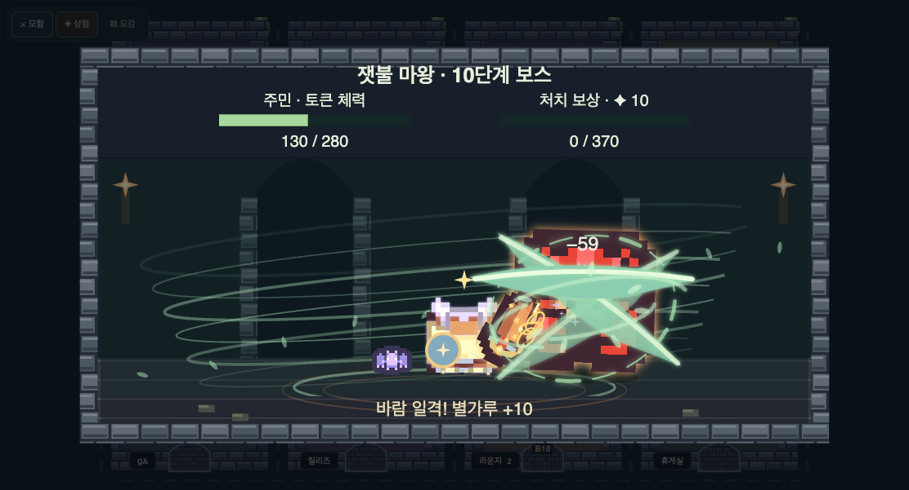 |

<details>
<summary><strong>안개 · 시차를 둔 연속 참격도 보기</strong></summary>

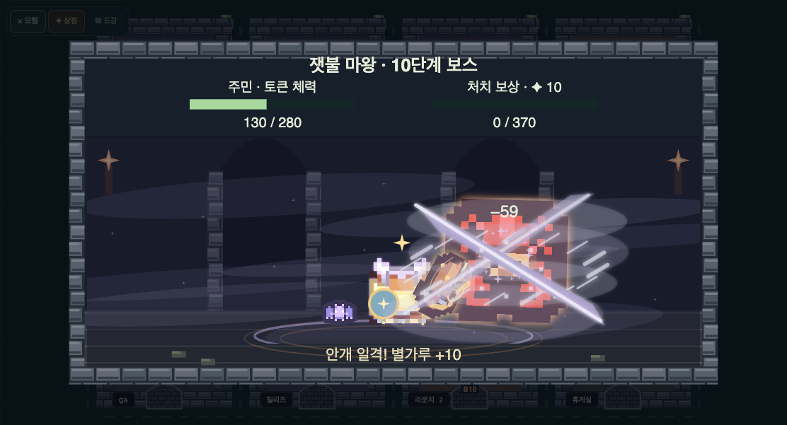

</details>

### 작은 주민의 대역전, 전설의 검

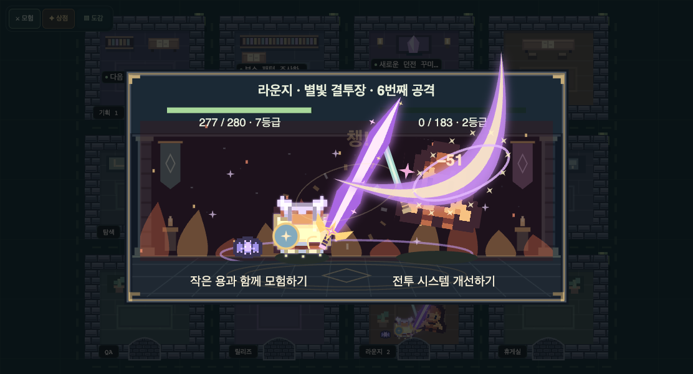

작은 몸집에서 터져 나오는 커다란 한 방. 긴 기 모으기와 빛나는 검, 초승달 참격으로 전세를 뒤집습니다. **베기 → 상대 쓰러짐 → 검이 부드럽게 줄어듦 → 전투 종료**까지 이어집니다.

작은 쪽이 전설검 후보일 때, 누적 토큰 **10M 이하에서는 40%, 그보다 많으면 20%** 확률로 발동합니다. 몬스터에게 연속으로 패배한 주민을 위한 전설검 구제 장치도 있습니다.

## 내 세션만의 장비와 작은 동행

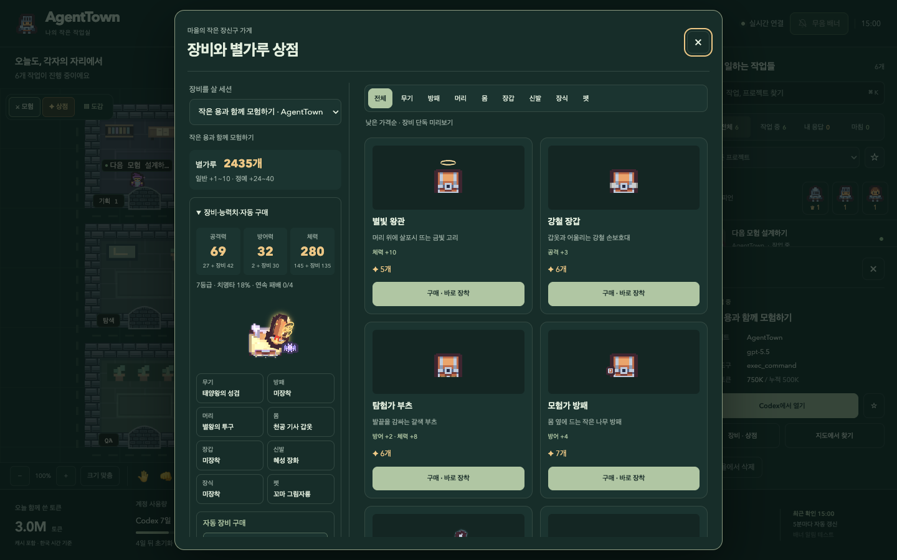

별가루를 모아 **56종의 아이템** 중에서 골라 보세요. 무기·방패·머리·몸·장갑·신발·장식·펫까지, 세션마다 독립된 지갑과 장비를 가집니다.

- 전체·부위별 목록을 **낮은 가격순**으로 정렬합니다. 상품 카드에는 해당 장비만 미리 보여주고, 현재 착용 모습은 별도로 확인할 수 있습니다.
- 구매한 장비의 공격력·방어력·체력 등 능력치가 전투에 반영됩니다.
- 화려한 상위 무기, 날개와 장식, 곁을 따라다니는 작은 용과 불사조를 장착할 수 있습니다.
- 무기는 전투할 때 등장하고, 액세서리와 펫은 마을에서도 함께합니다.
- 공격·방어 중심 등 자동 장비 선택을 세션별로 설정할 수 있습니다.

<details>
<summary><strong>좁은 화면에서도 상품부터 보기</strong></summary>

장비·능력치·자동 구매 설정을 접어 상품과 가격을 먼저 보여줍니다. 필요할 때 펼쳐 기존 장비와 자동 구매 방식을 확인할 수 있습니다.

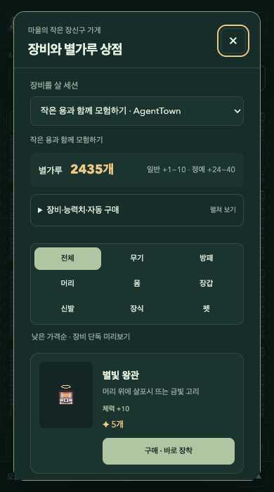

</details>

## 혼자서는 버거운 보스도, 함께라면

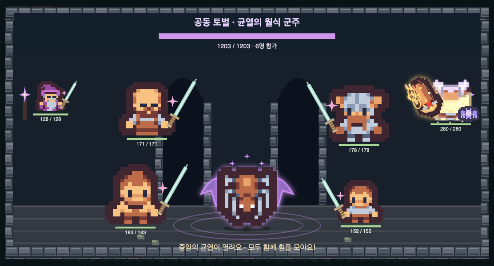

중앙에 균열이 열리면 **휴게실을 제외한 참여 가능한 주민들**이 모여 보스에 맞섭니다. 주민은 토큰에 따른 몸집 차이를 유지한 채 흩어 서며, 배치는 전투마다 달라집니다. 보스는 한 명을 연속으로 공격하거나 여러 주민을 공격할 수 있습니다. 낮은 등급의 참가자는 승리 시 성장 보너스를 받아 다음 장비에 더 빨리 다가갑니다.

모험 중 만나는 희귀 보물 몬스터, 함께 싸운 친구와 라이벌, 발견한 보스의 기록은 **모험 도감**에 남습니다. 세션이 마을을 떠나도 그 기억은 유지됩니다.

<details>
<summary><strong>모험 도감 펼쳐 보기</strong></summary>

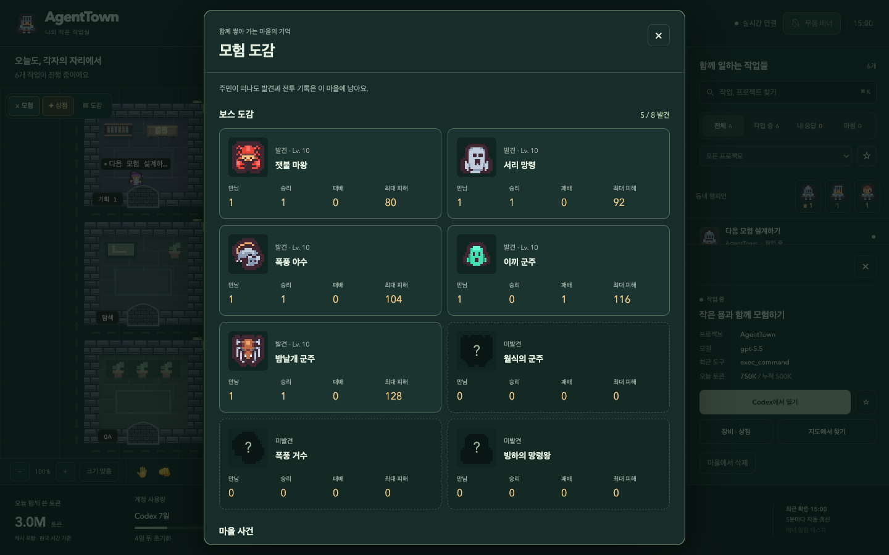

</details>

## 시작하기

**기본 데스크톱 앱은 Codex의 로컬 작업 기록이 있는 PC**에서 사용합니다. Claude Code 기록용 모듈도 포함되어 있으며, 별도 실행 방법은 아래 안내를 참고하세요. 일반 ChatGPT 웹 대화를 읽는 앱은 아닙니다.

| 환경 | 실행 방법 |
| --- | --- |
| macOS 앱 | 전달받거나 직접 빌드한 `AgentTown.app` 실행. 창을 닫으면 메뉴 막대에 남습니다. |
| Windows ZIP | `AgentTown-Windows-x64.zip` 전체 압축 해제 → `설치.cmd` 실행. Python·Node.js 별도 설치 없이 사용합니다. |
| 소스에서 실행 | Python 3 환경에서 저장소 루트의 `./launch.sh` 실행 → `http://127.0.0.1:8766` 접속. |

**설치 파일은 소스 저장소에 포함되어 있지 않습니다.** 패키지 생성, Windows EXE 빌드, 환경 변수와 플랫폼별 검증 범위는 [설치·실행 안내](docs/INSTALL.md)에 정리했습니다.

```sh
git clone https://github.com/Harry1757/agenttown.git
cd agenttown
./launch.sh
```

### Claude Code로 실행하기

Claude Code의 로컬 기록은 별도 진입점으로 읽을 수 있습니다.

```sh
python3 claudetown.py
```

기본 접속 주소는 `http://127.0.0.1:8765`입니다. 현재 데스크톱 앱의 기본 서버와 계정 한도 조회·작업 바로 열기는 Codex용입니다. 두 제공자의 기록을 한 목록으로 합치는 기능은 아직 제공하지 않습니다.

### 기존 CodexTown 사용자

앱 이름을 AgentTown으로 바꿨습니다. 기존 장비·별가루·도감·알림 설정을 이어 쓰도록 저장 폴더와 내부 식별자는 유지합니다. `CODEXTOWN_*` 환경 변수도 그대로 사용할 수 있습니다.

### 내 작업 기록은 어디로 가나요?

세션은 기본적으로 `~/.codex`의 로컬 기록을 읽습니다. 서버는 `127.0.0.1`에만 열리고, 코드 본문·도구 결과·인증 토큰을 화면에 보내지 않습니다. 계정 한도는 로그인된 Codex의 App Server로 조회하며, 새 모델 작업을 실행하지 않습니다.

장비·별가루·도감·즐겨찾기는 로컬에 저장됩니다. 게임 연출은 실제 Codex 작업을 실행하거나 모델 성능을 높이지 않습니다. 토큰 표시 역시 청구 금액을 계산하는 지표는 아닙니다. 수집 범위와 상태 추정의 한계는 [데이터와 한계](docs/INSTALL.md#데이터와-한계)를 확인해 주세요.

## 만드는 데 사용한 것들

**Python**으로 세션 기록을 읽고, **Server-Sent Events(SSE)**로 상태를 전달합니다. 마을과 전투는 **Canvas 2D와 JavaScript**, 데스크톱 앱은 **Electron**으로 구성되어 있습니다.

ClaudeTown의 도트 마을에서 시작해 Codex 작업실과 작은 던전 모험으로 확장했습니다. 픽셀 아트는 **Kenney**의 Tiny Town, Tiny Dungeon, Roguelike Indoor, Roguelike Characters 에셋을 사용합니다. 에셋 라이선스는 CC0이며, 원문은 [마을·던전 에셋](assets/LICENSE.txt)과 [캐릭터·장비 에셋](assets/LICENSE-equipment.txt)에 보존되어 있습니다.

---

<div align="center">

**작업은 차근차근. 모험은 틈틈이.**<br>
AgentTown · 나의 작은 작업실

</div>
